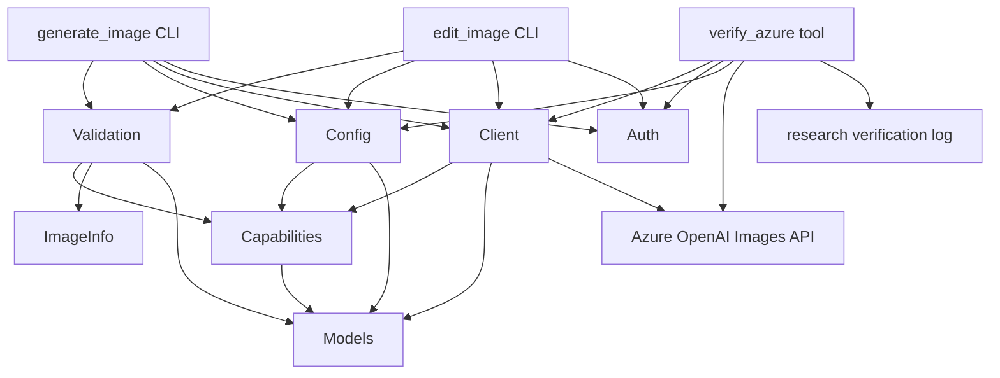
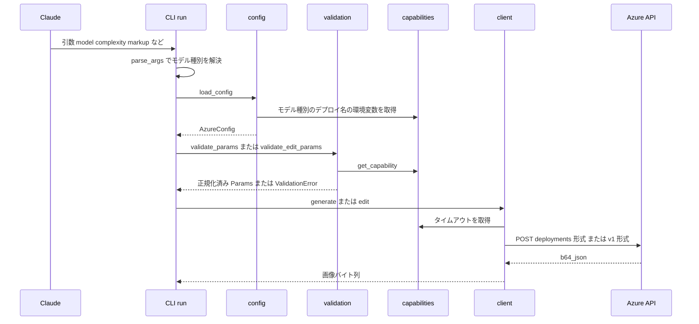
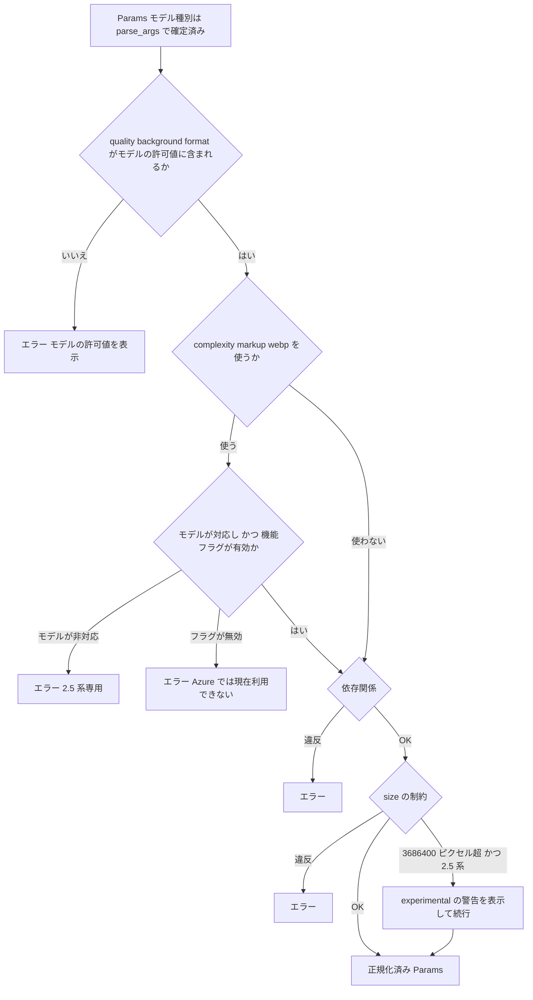

# 技術設計書: gpt-image-2-5-support

## Overview

**Purpose**: 本機能は、実装済みの `gpt-image` スキルで、Azure AI Foundry の `gpt-image-2.5-flare`（速度重視）と `gpt-image-2.5-sunburst`（精度重視）を使えるようにする。モデル種別ごとに使える値と機能を 1 か所にまとめて宣言し、既存の「API 呼び出し前に検証する（Fail Fast）」方針のまま、モデルに合わない値を事前に検出する。

**Users**: Claude（`SKILL.md` の手順でスクリプトを呼ぶ）とスキル利用者（`.env` でモデルとデプロイを設定する開発者）が使う。用途は「ラフ案は Flare、仕上げは Sunburst」という使い分けと、2.5 系で追加された品質・背景・complexity・markup の利用。

**Impact**: 既存の生成・編集パイプライン（`parse_args → load_config → validate → resolve_auth → generate/edit → save`）は変えない。各段がモデル種別を参照するようにし、モデルの知識は新しいモジュール `capabilities.py` に集める。モデル種別を指定しない場合は `gpt-image-2` として扱い、従来と同じ動作を保つ。

### Goals
- モデル種別（`gpt-image-2` / `gpt-image-2.5-flare` / `gpt-image-2.5-sunburst`）を指定でき、モデル種別ごとにデプロイを切り替えられる
- quality・background・format・complexity・markup の許可値を、モデル種別に応じて API 呼び出し前に検証する
- 機能ごとのフラグで、Azure での動作に合わせて有効・無効を切り替えられる。complexity と markup は最初から有効にし、Azure で拒否されると確認されたら無効にする（6.6, 7.7）。WebP は最初は無効にし、実機で確認してから有効にする（8.1）
- 既存の 118 件のテストを、アサーションを変えずに成功させる

### Non-Goals
- GPT Image 2.6、GIF / SVG 出力、ストリーミング、Batch API、Responses API
- デプロイ名からのモデル種別の自動推定
- CLI 間で重複している既定値解決処理（`ENV_DEFAULTS` / `pick_*`）の共通化リファクタ
- トークン使用量の集計・表示

## Boundary Commitments

### This Spec Owns
- モデル種別ごとの対応表（許可値・対応機能・タイムアウト・デプロイ名の環境変数）と、Azure 検証済み機能のフラグ
- モデル種別の解決（`--model` > `GPT_IMAGE_MODEL` > `gpt-image-2`）と、モデル種別ごとのデプロイ名の解決
- 新しいパラメータ `--model` / `--complexity` / `--markup` の CLI・検証・リクエストへの反映
- 画像ヘッダからの寸法読み取り（markup と先頭画像の寸法一致の確認用）
- Azure の実機で 2.5 系の機能の可否を確認する検証ツールと、その結果の記録先（`research/`）
- エンドポイント形式（deployments 形式 / v1 形式）の切り替えと、それに伴う Entra ID トークンのスコープの選択（`auth.resolve_auth` にスコープの引数を追加する最小限の変更）
- 検証を通さずにリクエストを送る公開関数 `client.post_raw`（検証ツール用の約束事）
- `SKILL.md`・README（英語版・日本語版）・`.env.example`・steering の `tech.md` への 2.5 系の記載

### Out of Boundary
- 認証の方式（Entra ID を優先し、API キーにフォールバックする順序）と、資格情報の取得方法。この仕様で変えるのはトークンのスコープを引数で受け取れるようにすることだけ
- 保存処理（`storage.py`）のファイル名規則（`webp` は既存の拡張子対応でそのまま `.webp` になるため変更しない）
- 429 リトライの方式と回数
- 既存仕様 `gpt-image-2-skill` で定めた要件のうち、本書で変更すると明記していないもの

### Allowed Dependencies
- Python 3.10+ の標準ライブラリ（`struct`、`zlib`、`dataclasses`、`typing` など）
- 既存の依存ライブラリ `requests`、`azure-identity`（**新しい依存は追加しない。Pillow も使わない**）
- 依存の向き: `models` → `capabilities` → `config` / `image_info` / `auth` → `validation` → `client` → CLI（`generate_image` / `edit_image`）・`verify_azure`。右から左への import は禁止する（`capabilities` は `models` 以外を import しない）。`verify_azure` は `client` の公開関数（`post_raw`、`build_url`）だけを使い、`_` で始まる内部関数は使わない

### Revalidation Triggers
- `capabilities.py` の機能フラグ（`AZURE_ENABLED`）を変更したとき → `SKILL.md` の記載と、検証結果の記録（`research/`）を見直す
- モデル種別を追加したとき（例: 2.6 が Azure で提供されたとき） → 対応表・`SKILL.md`・README・`.env.example`
- `AzureConfig` や `GenerationParams` / `EditParams` のフィールドを変更したとき → テストダブルと統合テスト
- Azure の api-version の既定値、エンドポイント形式の既定、トークンのスコープの既定を変更したとき → 検証ツールで再確認する
- `client.post_raw` / `client.build_url` のシグネチャを変更したとき → 検証ツール

## Architecture

### Existing Architecture Analysis
- **パイプライン**: CLI の `run()` が `load_config` / `resolve_auth` / `generate`（または `edit`）/ `save_images` を依存注入で受け取り、例外の種類ごとに `stderr` の接頭辞と終了コード 1 を返す。この構造を維持する
- **検証**: `validation.py` が size・列挙値・依存関係を検査し、`ValidationError` を送出する。補正が必要な場合は警告を `stderr` に出し、`dataclasses.replace` で正規化した Params を返す（compression の扱い）。experimental の警告もこの方式に合わせる
- **技術的負債への対処**: 許可値が argparse の `choices` と `validation.py` に二重に定義されている。モデルごとに値が変わるため、quality・format・background の `choices` を外し、検証を `validation.py` に一本化する
- **テスト**: `run()` には `load_config=lambda: FAKE_CONFIG`（引数なし）が注入されている。既存テストを変えないため、既定モデルでは `load_config` を従来どおり引数なしで呼ぶ（後述の設計判断 D3）

### Architecture Pattern & Boundary Map



**Architecture Integration**:
- **選んだパターン**: 「宣言的なモデル対応表 ＋ 既存パイプラインの拡張」（ギャップ分析の方式 C）。モデルの知識を `capabilities.py` に集め、他のモジュールはそれを参照するだけにする
- **責務の分け方**: `capabilities` は「何が許されるか」を宣言する。`validation` は「入力がそれに従っているか」を判定する。`config` は「どこへ送るか」を決める。`client` は「どう送るか」を担う
- **維持する既存パターン**: Fail Fast の検証、依存注入による `run()`、例外の種類ごとのエラー接頭辞、`CLI > 環境変数 > 組み込み既定` の優先順位、シークレットを環境変数からのみ読むこと
- **新しいコンポーネントを作る理由**:
  - `capabilities.py`: 3 つのモデルの差分を 1 か所で管理し、2.6 などの追加時にここだけ直せばよいようにする
  - `image_info.py`: 寸法の読み取りは検証の責務とは別で、単体でテストしたい
  - `tests/live/verify_azure.py`: 実機での検証は通常のテストとは別にし、費用がかかる処理を明示的に実行したときだけ動かす
- **steering との整合**: ロジックはスクリプトに集め、`SKILL.md` には手順と例だけを書く。シークレットは書かない。入力の検証は API 呼び出しの前に行う

### Technology Stack

| Layer | Choice / Version | Role in Feature | Notes |
|-------|------------------|-----------------|-------|
| CLI | Python 3.10+ `argparse` | `--model` / `--complexity` / `--markup` の追加 | quality・format・background の `choices` を外す |
| サービス層 | Python 標準ライブラリ（`dataclasses`、`typing.Literal`、`struct`、`zlib`） | 対応表、寸法の読み取り、検証ツールで使うテスト画像の生成 | **新しい依存はない** |
| HTTP | `requests` >= 2.31（既存） | 生成は JSON、編集は multipart。編集に `markup` のファイル部品を追加 | v1 形式ではボディに `model` を入れる |
| 外部 API | Azure OpenAI Images API（`images/generations`、`images/edits`） | deployments 形式（既定、`api-version=2025-04-01-preview`）と v1 形式（`/openai/v1/images/...`）の両方に対応 | 2.5 系の新しい値をどちらが受け付けるかは検証ツールで確認する |
| テスト | pytest（既存） | 単体テストと統合テストはモックを使う。実機検証は pytest の収集対象外のスクリプト | `pytest.ini` は変更しない |

## File Structure Plan

### Directory Structure
```
.claude/skills/gpt-image/
├── scripts/
│   ├── capabilities.py      # 新規: モデル種別の一覧、モデルごとの対応表、Azure 検証済み機能のフラグ
│   ├── image_info.py        # 新規: PNG・JPEG・WebP のヘッダから寸法を読む（標準ライブラリのみ）
│   ├── models.py            # 変更: ModelName 型、Params に model・complexity・markup、AzureConfig に api_style
│   ├── config.py            # 変更: load_config(model) でモデル種別ごとにデプロイを解決、API 形式とトークンのスコープの環境変数
│   ├── auth.py              # 変更: resolve_auth にトークンのスコープの引数を追加（既定は従来の値）
│   ├── validation.py        # 変更: 対応表に基づく検証、complexity・markup・webp、experimental の警告
│   ├── client.py            # 変更: 新しいフィールド、markup の部品、v1 形式の URL、モデル別のタイムアウト、公開関数 post_raw / build_url
│   ├── generate_image.py    # 変更: --model・--complexity、choices を外す、モデルに応じた load_config の呼び出し
│   └── edit_image.py        # 変更: generate_image と同じ変更 ＋ --markup
├── tests/
│   ├── test_capabilities.py # 新規
│   ├── test_image_info.py   # 新規
│   ├── test_model_selection.py   # 新規: モデル種別とデプロイの解決、CLI からの指定
│   ├── test_validation_2_5.py    # 新規: 2.5 系の許可値、complexity・markup・webp、警告
│   ├── test_client_2_5.py        # 新規: リクエスト内容、v1 形式、タイムアウト
│   └── live/
│       └── verify_azure.py  # 新規: Azure 実機の検証ツール（pytest の収集対象外）
├── SKILL.md                 # 変更
research/
└── azure-gpt-image-2.5-verification.md   # 新規: 検証ツールの結果を記録
```
既存のテストファイルは変更しない。

### Modified Files
- `scripts/models.py` — `ModelName`・`Complexity` 型を追加。`Quality` / `Background` / `OutputFormat` の値を 2.5 系に合わせて広げる。`GenerationParams` / `EditParams` に `model` と `complexity`、`EditParams` に `markup`、`AzureConfig` に `api_style` を追加する（すべて既定値を持たせ、既存の生成コードとの互換を保つ）
- `scripts/config.py` — `load_config(model: ModelName = DEFAULT_MODEL)`。モデル種別ごとのデプロイ名の環境変数を、フォールバック付きで解決する。`AZURE_OPENAI_API_STYLE` と `AZURE_OPENAI_TOKEN_SCOPE` を読む
- `scripts/auth.py` — `resolve_auth(api_key, credential=None, scope=TOKEN_SCOPE)`。既定のスコープは従来どおり `https://cognitiveservices.azure.com/.default`
- `scripts/validation.py` — モジュール定数の許可値を、対応表の参照に置き換える。既存のエラー文は gpt-image-2 では変えない
- `scripts/client.py` — `_build_url` を公開関数 `build_url` にし、API 形式に応じて分ける。検証を通さずに送る `post_raw` を追加し、`generate` / `edit` もこれを使う。`_build_body` / `_build_edit_data` に complexity を追加し、compression の対象を jpeg と webp にする。`edit` に markup の部品を追加する。`timeout` の既定を `None` にして、モデル別の値で補う
- `scripts/generate_image.py` / `scripts/edit_image.py` — 引数の追加、`ENV_DEFAULTS` に `model`・`complexity` を追加、quality・format・background の `choices` を外す、ヘルプと説明文を 2.5 系向けに更新する
- `SKILL.md`・`README.md`・`README.ja-JP.md`・`.env.example` — モデルの選び方、設定方法、新しいパラメータ、モデル種別ごとに使える値
- `.kiro/steering/tech.md` / `product.md` — 対象モデルに 2.5 系を追加し、WebP の記述を「Azure 未検証」に改める

## System Flows

### 生成・編集のリクエストの流れ（モデル種別の解決から送信まで）



**主な判断**:
- モデル種別は `parse_args` の段階で確定させ、Params に持たせる。以降の段は Params の `model` だけを参照する
- 未知のモデル種別は `parse_args` で検出する（`load_config` がモデル種別を必要とするため、検証より前に確定させる必要がある）。CLI 引数・環境変数のどちらから来た値でも、`parser.error` で受け付けるモデル種別の一覧を表示して非ゼロで終了する（1.3）
- 既定モデル（`gpt-image-2`）のときは、`run()` が `load_config()` を引数なしで呼ぶ。それ以外のときは `load_config(model)` を呼ぶ（D3）
- 検証は対応表に従う。機能フラグ（`AZURE_ENABLED`）が False の機能は、2.5 系であっても「Azure では現在利用できない」というエラーにする。初期値は complexity と markup が True、WebP が False
- `run()` は `resolve_auth(load_api_key(), scope=config.token_scope)` を呼ぶ。既存のテストダブルは `**kw` を受け取るため互換がある

### 検証のフロー（2.5 系の新しいパラメータ）



依存関係の確認には、markup と mask の排他、markup の形式・大きさ・寸法、透過と出力形式、compression と出力形式が含まれる。

## Requirements Traceability

| Requirement | Summary | Components | Interfaces | Flows |
|-------------|---------|------------|------------|-------|
| 1.1, 1.3 | 3 つのモデル種別、不正値のエラー | capabilities, CLI | `MODEL_NAMES`, `parse_args` | リクエストの流れ |
| 1.2 | モデル種別の優先順位 | CLI | `ENV_DEFAULTS["model"]` | リクエストの流れ |
| 1.4 | デプロイ名から推測しない | config | `load_config` | — |
| 2.1–2.4 | モデル種別ごとのデプロイ名とフォールバック、未設定時のエラー | config, capabilities | `load_config`, `ModelCapability.deployment_env` | リクエストの流れ |
| 2.5 | デプロイ名を CLI 引数で受け取らない | CLI | — | — |
| 3.1–3.3 | quality の許可値の切り替え | capabilities, validation, CLI | `ModelCapability.qualities` | 検証フロー |
| 3.4 | quality の既定は high | CLI | `ENV_DEFAULTS["quality"]` | — |
| 3.5, 12.1–12.6 | ドキュメント | SKILL.md, README, .env.example | — | — |
| 4.1–4.3 | background の opaque | capabilities, validation | `ModelCapability.backgrounds` | 検証フロー |
| 4.4 | 透過と出力形式 | validation, capabilities | `ModelCapability.transparent_formats` | 検証フロー |
| 5.1, 5.3, 5.4 | size の制約 | validation | `_validate_size` | 検証フロー |
| 5.2 | experimental の警告 | validation, capabilities | `ModelCapability.experimental_pixels` | 検証フロー |
| 6.1–6.5 | complexity | CLI, validation, client | `Params.complexity`, `_build_body` | 両フロー |
| 6.6, 7.7, 8.1 | Azure の検証結果による有効・無効 | capabilities | `AZURE_ENABLED` | 検証フロー |
| 7.1–7.6 | markup | edit CLI, validation, image_info, client | `EditParams.markup`, `read_dimensions` | 両フロー |
| 8.2–8.4 | WebP | capabilities, validation, client | `ModelCapability.formats`, `compression_formats` | 検証フロー |
| 9.1–9.4 | Azure 実機の検証ツールと記録 | verify_azure, client | `ProbeResult`, `post_raw` | — |
| 9.5 | api-version、v1 形式、トークンのスコープ | config, client, auth | `AzureConfig.api_style`, `AzureConfig.token_scope`, `build_url`, `resolve_auth` | リクエストの流れ |
| 10.1–10.3 | タイムアウト | capabilities, client | `ModelCapability.timeout_generate` / `timeout_edit` | リクエストの流れ |
| 11.1–11.4 | 後方互換 | 全コンポーネント | 既定値、D3 | — |

## Components and Interfaces

| Component | Domain/Layer | Intent | Req Coverage | Key Dependencies | Contracts |
|-----------|--------------|--------|--------------|------------------|-----------|
| capabilities | 型と宣言 | モデル種別ごとの許可値・機能・タイムアウト・デプロイ名の環境変数と、Azure 検証済みフラグを宣言する | 1.1, 2.1, 3.1, 3.2, 4.1, 4.2, 5.2, 6.6, 7.7, 8.1, 10.1, 10.3 | models (P0) | Service, State |
| image_info | ユーティリティ | 画像ヘッダから寸法を読む | 7.6 | 標準ライブラリ (P0) | Service |
| models（変更） | 型 | Params・AzureConfig へのフィールド追加 | 1.1, 6.1, 7.1, 9.5 | — | State |
| config（変更） | 設定 | モデル種別ごとのデプロイの解決、API 形式 | 1.4, 2.1–2.5, 9.5 | capabilities (P0) | Service |
| validation（変更） | 検証 | 対応表に基づく Fail Fast の検証と警告 | 3.1–3.3, 4.1–4.4, 5.1–5.4, 6.4, 6.5, 7.3–7.6, 8.1–8.4 | capabilities (P0), image_info (P1) | Service |
| client（変更） | HTTP | リクエストの組み立て、URL の形式、タイムアウト、検証を通さない送信 | 6.2, 6.3, 7.2, 8.2, 9.1, 9.5, 10.1–10.3, 11.2 | capabilities (P0), requests (P0) | Service, API |
| auth（変更） | 認証 | トークンのスコープを引数で受け取る | 9.5 | azure-identity (P0) | Service |
| CLI（変更） | エントリポイント | 引数の追加、モデル種別の解決と未知の値の拒否、load_config の呼び出し | 1.2, 1.3, 2.5, 3.4, 6.1, 7.1, 11.1, 11.3 | 全モジュール (P0) | Service |
| verify_azure | 開発ツール | Azure 実機で項目ごとの可否を確認して記録する | 9.1–9.5 | config (P0), client.post_raw (P0), auth (P0) | Batch |
| ドキュメント | ドキュメント | 使い分けと設定方法 | 3.5, 12.1–12.6 | — | — |

### 型と宣言

#### capabilities

| Field | Detail |
|-------|--------|
| Intent | モデル種別ごとの違いを宣言する唯一の場所 |
| Requirements | 1.1, 2.1, 3.1, 3.2, 4.1, 4.2, 5.2, 6.6, 7.7, 8.1, 10.1, 10.3 |

**Responsibilities & Constraints**
- モデル種別の一覧と既定値（`DEFAULT_MODEL = "gpt-image-2"`）を持つ
- モデルごとの「宣言上の対応」と「Azure で検証済みか」を分けて持ち、実際に使えるかどうかは両方を満たすことを条件にする
- `models` 以外を import せず、副作用を持たない（環境変数は読まない）

**Dependencies**
- Inbound: config, validation, client, verify_azure — 対応表の参照（P0）
- Outbound: models — `ModelName` などの型（P0）

**Contracts**: Service [x] / State [x]

##### Service Interface
```python
ModelName = Literal["gpt-image-2", "gpt-image-2.5-flare", "gpt-image-2.5-sunburst"]
Feature = Literal["complexity", "markup", "webp"]

@dataclass(frozen=True)
class ModelCapability:
    name: ModelName
    qualities: frozenset[str]            # 2: low/medium/high, 2.5: + xhigh/max/auto
    backgrounds: frozenset[str]          # 2: auto/transparent, 2.5: + opaque
    base_formats: frozenset[str]         # 両方: png/jpeg（webp はフラグで追加）
    declared_features: frozenset[Feature]   # 2: 空, 2.5: complexity/markup/webp
    experimental_pixels: Optional[int]   # 2: None, 2.5: 3_686_400
    timeout_generate: float              # 2: 120.0, 2.5: 300.0
    timeout_edit: float                  # 2: 180.0, 2.5: 300.0
    deployment_env: str                  # 例: AZURE_OPENAI_DEPLOYMENT_GPT_IMAGE_2_5_FLARE

MODEL_NAMES: tuple[ModelName, ...]
DEFAULT_MODEL: ModelName
AZURE_ENABLED: Mapping[Feature, bool]    # 初期値: complexity=True, markup=True, webp=False。検証結果に基づいて変更する

def get_capability(model: str) -> ModelCapability: ...        # 未知のモデルなら KeyError
def is_feature_enabled(cap: ModelCapability, feature: Feature) -> bool: ...
def allowed_formats(cap: ModelCapability) -> frozenset[str]: ...           # base ＋ 有効なら webp
def transparent_formats(cap: ModelCapability) -> frozenset[str]: ...       # png ＋ 有効なら webp
def compression_formats(cap: ModelCapability) -> frozenset[str]: ...       # jpeg ＋ 有効なら webp
```
- 事前条件: なし（純粋関数）
- 事後条件: `is_feature_enabled` は「宣言上の対応がある」かつ「`AZURE_ENABLED[feature]` が True」のときだけ True を返す
- 不変条件: `gpt-image-2` の対応表は既存の定数（`VALID_QUALITY` など）と同じ値を持つ

**Implementation Notes**
- モデル種別ごとのデプロイ名の環境変数は `AZURE_OPENAI_DEPLOYMENT_` に、モデル名を大文字にして `-` と `.` を `_` に置き換えたものを付けた名前とする（例: `AZURE_OPENAI_DEPLOYMENT_GPT_IMAGE_2_5_SUNBURST`）
- `AZURE_ENABLED` を環境変数で上書きできるようにはしない。利用者が誤って WebP など未確認の機能を有効にしないためと、有効・無効を変えた根拠をコードレビューで確認できるようにするため（D5）
- リスク: Azure の対応状況が変わったときに、この表が古くなる → Revalidation Triggers に従い、検証ツールで再確認する

### ユーティリティ

#### image_info

| Field | Detail |
|-------|--------|
| Intent | 依存ライブラリを使わずに、画像ファイルの表示上の幅と高さを読む |
| Requirements | 7.6 |

**Contracts**: Service [x]

##### Service Interface
```python
@dataclass(frozen=True)
class Dimensions:
    width: int
    height: int

def read_dimensions(path: str) -> Optional[Dimensions]: ...
```
- 対応する形式: PNG（IHDR）、JPEG（SOFn マーカー。EXIF の Orientation が 5〜8 なら幅と高さを入れ替える）、WebP（`VP8 ` / `VP8L` / `VP8X` チャンク）
- 事後条件: 形式を判定できない、またはヘッダが壊れている場合は `None` を返す（例外にしない）
- ファイル全体は読まず、ヘッダの解析に必要な範囲だけを読む

**Implementation Notes**
- 検証側は `None` のとき寸法の一致確認を省き、警告を `stderr` に出して API の判定に任せる（D6）
- リスク: 珍しい JPEG（プログレッシブ JPEG、EXIF が複数ある場合）→ 単体テストで代表的な形式を網羅する

### 設定

#### config（変更）

| Field | Detail |
|-------|--------|
| Intent | モデル種別に応じて、呼び出し先のデプロイと API 形式を決める |
| Requirements | 1.4, 2.1–2.5, 9.5 |

**Contracts**: Service [x]

##### Service Interface
```python
API_STYLE_ENV = "AZURE_OPENAI_API_STYLE"         # "deployments"（既定）または "v1"
ApiStyle = Literal["deployments", "v1"]

def load_config(model: ModelName = DEFAULT_MODEL) -> AzureConfig: ...
```
- デプロイ名は「`capability.deployment_env` → `AZURE_OPENAI_DEPLOYMENT`」の順に探す
- 事後条件: どちらも未設定なら `ConfigError` を送出する。メッセージには両方の環境変数名を含め、値は含めない
- `api_style` が v1 で、`AZURE_OPENAI_API_VERSION` が未設定のときは `preview` を既定にする。deployments 形式の既定（`2025-04-01-preview`）は変えない
- 不正な `AZURE_OPENAI_API_STYLE` の値は `ConfigError` にする
- `token_scope` は `AZURE_OPENAI_TOKEN_SCOPE` があればその値、なければ `https://cognitiveservices.azure.com/.default`（従来の値）とする。API 形式によって既定を変えるかどうかは、検証ツールの結果で決める（v1 形式で従来のスコープが 401 になった場合だけ既定を変える）

`AzureConfig` に追加するフィールド: `api_style: ApiStyle = "deployments"`、`token_scope: str = TOKEN_SCOPE`

### 検証

#### validation（変更）

| Field | Detail |
|-------|--------|
| Intent | Params を対応表に照らして検証し、正規化した Params を返す |
| Requirements | 3.1–3.3, 4.1–4.4, 5.1–5.4, 6.4, 6.5, 7.3–7.6, 8.1–8.4 |

**Contracts**: Service [x]

##### Service Interface（公開シグネチャは既存のまま）
```python
def validate_params(params: GenerationParams) -> GenerationParams: ...
def validate_edit_params(params: EditParams) -> EditParams: ...
```
- 検査の順序は検証フローの図に従う
- エラー文には、モデル種別の名前と、そのモデルで使える値を含める
- markup の検査: mask との排他 → 存在・PNG・50MB 以下 → 寸法の一致（`read_dimensions` で先頭画像と markup の両方を読み、どちらかが `None` なら警告して続行）
- experimental の警告: 2.5 系で、size が `auto` 以外で、総ピクセル数が `experimental_pixels` を超えるときに、`stderr` に 1 行出す（既存の compression の警告と同じ方式）
- 互換性: `gpt-image-2` では、既存のエラー文（例: 「WEBP は Azure 非対応」「format=png が必須」）を変えない

### HTTP

#### client（変更）

| Field | Detail |
|-------|--------|
| Intent | モデル種別と API 形式に合わせてリクエストを組み立てて送る |
| Requirements | 6.2, 6.3, 7.2, 8.2, 9.5, 10.1–10.3, 11.2 |

**Contracts**: Service [x] / API [x]

##### Service Interface（追加する公開関数）
```python
Operation = Literal["generations", "edits"]

@dataclass(frozen=True)
class RawResponse:
    status: int
    body: Mapping[str, object]   # JSON として読めない場合は {"raw_text": ...}

def build_url(config: AzureConfig, operation: Operation) -> str: ...

def post_raw(
    config: AzureConfig,
    auth: AuthHeader,
    operation: Operation,
    *,
    json_body: Optional[Mapping[str, object]] = None,      # generations
    form: Optional[Mapping[str, str]] = None,             # edits のテキストフィールド
    files: Optional[Sequence[tuple[str, tuple[str, bytes, str]]]] = None,  # edits のファイル部品
    timeout: float,
    http_post: Optional[Callable] = None,
) -> RawResponse: ...
```
- 事前条件: `json_body` と `form` / `files` のどちらか一方だけを指定する
- 事後条件: HTTP のステータスにかかわらず `RawResponse` を返す（エラーを例外にしない）。通信エラーとタイムアウトだけは `ApiError` を送出する。v1 形式では、`json_body` または `form` に `model`（デプロイ名）を自動で加える
- `generate` / `edit` は、`post_raw` の結果にリトライ・エラー分類・Base64 デコードを加えたものとして作り直す。`http_post` を注入する既存テストの動きは変えない

##### API Contract

| 形式 | Method | Endpoint | Request | Response | Errors |
|------|--------|----------|---------|----------|--------|
| deployments | POST | `{endpoint}/openai/deployments/{deployment}/images/generations?api-version={v}` | JSON（既存のフィールド ＋ `complexity`） | `data[].b64_json` | 400, 401, 403, 429 |
| deployments | POST | `{endpoint}/openai/deployments/{deployment}/images/edits?api-version={v}` | multipart: `image[]`（複数）、`mask` または `markup`（ファイル部品）、テキストのフィールド | 同上 | 同上 |
| v1 | POST | `{endpoint}/openai/v1/images/{generations,edits}?api-version={v}` | deployments 形式と同じ ＋ `model`（デプロイ名） | 同上 | 同上 |

- `complexity` は Params に値があるときだけ送る（gpt-image-2 では検証で弾かれるため、届くことはない）
- `output_compression` は `output_format` が `compression_formats` に含まれるときだけ送る
- `markup` のファイル部品は、OpenAI の仕様（`-F markup=@file;type=image/png`）に合わせてフィールド名を `markup`、MIME を `image/png` にする。Azure での受け付けは検証ツールで確認する（R3）
- タイムアウト: `generate(..., timeout: Optional[float] = None)` / `edit(..., timeout: Optional[float] = None)`。`None` のときは対応表のモデル別の値を使う。gpt-image-2 では 120 秒と 180 秒で、従来と同じ
- 400 のエラー文に「モデル種別（`--model` / `GPT_IMAGE_MODEL`）とデプロイが一致しているか」の確認を促す一文を加える

### エントリポイント

#### CLI（generate_image / edit_image、変更）

**概要のみ**（新しい境界は持たない）
- 追加する引数: `--model`（`GPT_IMAGE_MODEL`、既定 `gpt-image-2`。未知の値は `parse_args` で `parser.error`）、`--complexity`（`GPT_IMAGE_COMPLEXITY`、既定は未指定）、`--markup`（編集のみ、環境変数なし）
- quality・format・background の argparse の `choices` を外し、値の検査を validation に一本化する（D2）
- `run()` は、`params.model == DEFAULT_MODEL` のとき `load_config()` を、それ以外のとき `load_config(params.model)` を呼ぶ（D3）
- 説明文（`description`）とヘルプを、「gpt-image-2 / 2.5 系」の両方を指す表現にする

### 開発ツール

#### verify_azure

| Field | Detail |
|-------|--------|
| Intent | Azure の実機で、2.5 系の項目ごとの可否を確認し、Markdown で記録する |
| Requirements | 9.1–9.5 |

**Contracts**: Batch [x]

##### Batch / Job Contract
- **起動**: 開発者が `python tests/live/verify_azure.py --model gpt-image-2.5-flare [--out <path>]` を手動で実行する。ファイル名が `test_*.py` ではないため、pytest は収集しない（9.2）
- **前提**: `AZURE_OPENAI_ENDPOINT` と、対象モデルのデプロイ名（モデル種別ごとの環境変数か `AZURE_OPENAI_DEPLOYMENT`）が設定されていること。設定されていなければ API を呼ばずに終了する。設定は `load_config(model)` で読む
- **入力**: 確認項目は、deployments 形式と v1 形式のそれぞれについて次のとおり: `quality` ∈ {xhigh, max, auto}、`background` ∈ {opaque, transparent}、`output_format=webp`、`complexity=low`、edits の `markup`。v1 形式では、トークンのスコープを `https://cognitiveservices.azure.com/.default` と `https://ai.azure.com/.default` の両方で試す（Entra ID の場合のみ）。費用を抑えるため、ほかのパラメータは `quality=low`（確認対象の項目以外）、`size=1024x1024`、`n=1` にする
- **処理**: 項目ごとに `client.post_raw` で 1 回ずつリクエストする（検証は通さない）。API 形式は `dataclasses.replace(config, api_style="v1")`、スコープは `resolve_auth(api_key, scope=...)` で切り替える。edits で使うベース画像と markup 画像は、標準ライブラリ（`zlib`）で PNG を生成する
- **出力**: 項目ごとの `ProbeResult(item, api_style, token_scope, accepted: bool, status: int, error_code: Optional[str], message: str)` を Markdown の表にして `--out`（既定は標準出力）に書く。開発者はこれを `research/azure-gpt-image-2.5-verification.md` に記録する（9.3, 9.4）
- **冪等性・復旧**: 項目ごとに独立していて、途中で失敗しても残りの項目を続ける。429 は既存と同じ指数バックオフで再試行する
- **安全性**: キーとトークンは出力しない。エラーの本文はそのまま記録するが、認証ヘッダは記録しない

## Data Models

### Domain Model
- **ModelCapability**（値オブジェクト・不変）: モデル種別ごとに 1 つ。`capabilities.py` だけが作る
- **GenerationParams / EditParams**（値オブジェクト・不変）: 次のフィールドを追加する。すべて既定値があるため、既存の生成コードはそのまま動く

| フィールド | 型 | 既定 | 対象 |
|---|---|---|---|
| `model` | `ModelName` | `"gpt-image-2"` | 両方 |
| `complexity` | `Optional[Complexity]`（`low` / `medium` / `high`） | `None` | 両方 |
| `markup` | `Optional[str]`（ファイルパス） | `None` | EditParams のみ |

- `Quality` は `low` / `medium` / `high` / `xhigh` / `max` / `auto`、`Background` は `auto` / `opaque` / `transparent`、`OutputFormat` は `png` / `jpeg` / `webp` に広げる。モデルごとに実際に使える値は `ModelCapability` が決める
- **AzureConfig**: `api_style: ApiStyle = "deployments"` を追加する
- **不変条件**: `markup` と `mask` は同時に値を持たない（validation が保証する）

## Error Handling

### Error Strategy
既存の例外の分類（ValidationError / ConfigError / AuthError / ApiError / OSError）と、`stderr` の接頭辞・終了コード 1 を維持する。新しいエラーはすべて ValidationError か ConfigError として、API を呼ぶ前に返す。

### Error Categories and Responses

| 状況 | 分類 | メッセージに含めるもの |
|---|---|---|
| 未知のモデル種別（CLI 引数・環境変数） | 引数エラー（`parser.error`、終了コード 2） | 受け付けるモデル種別の一覧と、値の出どころ（`--model` か `GPT_IMAGE_MODEL` か） |
| モデルで使えない quality / background / format | ValidationError | モデル種別の名前と、使える値の一覧 |
| gpt-image-2 で complexity / markup | ValidationError | 「2.5 系モデル専用」であること |
| 2.5 系で、機能フラグが無効な機能（初期状態では WebP） | ValidationError | 「Azure では現在利用できない」ことと、`SKILL.md` の参照先 |
| markup と mask の併用 | ValidationError | 併用できないこと |
| markup の形式・大きさ・寸法の不一致 | ValidationError | ファイルパス、上限値、両方の寸法 |
| デプロイ名が決まらない | ConfigError | モデル種別ごとの環境変数名と `AZURE_OPENAI_DEPLOYMENT` |
| 不正な `AZURE_OPENAI_API_STYLE` | ConfigError | 受け付ける値 |
| Azure の 400 | ApiError(bad_request) | 既存の文言 ＋ モデル種別とデプロイの一致の確認 |
| experimental な解像度 | 警告（続行） | その解像度と、experimental であること |
| 寸法を読み取れない | 警告（続行） | 確認を省いたこと |

**終了コードの変化（D2）**: quality・format・background の不正値は、これまで argparse が終了コード 2 で弾いていた。今後は ValidationError として終了コード 1 になる。どちらも非ゼロであり、既存テストは `code != 0` だけを確認している。要件 11.3 の「終了コードを変えない」は、「成功は 0、失敗は非ゼロ」という契約を守ることと解釈する。

## Testing Strategy

### Unit Tests
- `capabilities`: モデルごとの許可値、`is_feature_enabled` がフラグと宣言の両方に従うこと、gpt-image-2 の表が既存の定数と一致すること、環境変数名の生成規則
- `image_info`: PNG・JPEG（EXIF の Orientation 6 で入れ替わる場合を含む）・WebP（VP8 / VP8L / VP8X）の寸法、壊れたファイルや未対応形式で `None` になること
- `validation`: 2.5 系での xhigh・max・auto・opaque の受け付け、gpt-image-2 での拒否、experimental の警告の有無と境界値（3,686,400 ちょうどでは警告しない）、complexity・markup・webp が「モデル非対応」「フラグが無効」「有効」の 3 つの状態でそれぞれ期待どおりになること（フラグは monkeypatch で切り替える）、初期状態で complexity と markup が使え、WebP が使えないこと、markup と mask の排他、寸法の不一致
- `config`: モデル種別ごとの環境変数を優先すること、フォールバック、両方ないときのエラー文、API 形式の既定と不正値、トークンのスコープの既定と上書き
- `auth`: `scope` を指定したときに、そのスコープでトークンを取得すること（既定は従来の値）
- `client.post_raw`: エラーのステータスでも例外にせず `RawResponse` を返すこと、v1 形式で `model` が加わること

### Integration Tests
- CLI の `run()` に `--model gpt-image-2.5-flare --quality xhigh` を渡し、実際の client を偽の `http_post` で動かして、リクエストのボディ・URL・タイムアウト（300 秒）を確認する
- 編集で `--markup` を渡し、multipart に `markup` の部品が入り、`mask` が入らないことを確認する（機能フラグを有効にした状態）
- v1 形式で、URL が `/openai/v1/images/...` になり、ボディに `model` が入ることを確認する
- 既定モデルで、`load_config` が引数なしで呼ばれ、リクエストの内容が従来と同じであることを確認する（後方互換）
- 既存の 118 件のテストを、変更せずにすべて成功させる（11.4）

### 実機での検証（手動）
- `verify_azure.py` を Flare と Sunburst のそれぞれで実行し、結果を `research/azure-gpt-image-2.5-verification.md` に記録する。その結果に基づいて `AZURE_ENABLED`（complexity・markup が拒否されれば False、WebP が受け付けられれば True）、トークンのスコープの既定、`SKILL.md` を更新する

## Security Considerations
- モデル種別ごとのデプロイ名は環境変数からのみ読み、CLI 引数では受け取らない（2.5）
- 検証ツールの出力（Markdown）には、エンドポイント・デプロイ名・キー・トークンを含めない。結果の表には項目・形式・ステータス・エラーコード・エラー文だけを載せる
- markup や入力画像の寸法の読み取りでは、ファイルの先頭の必要な範囲だけを読み、宣言された長さを上限まで確認してから読む（壊れたファイルで過大な読み込みをしない）

## Performance & Scalability
- 2.5 系のタイムアウトは生成・編集とも 300 秒にする（OpenAI のドキュメントで「最大 2 分」とされている処理時間に余裕を持たせる）
- 寸法の読み取りはヘッダだけを対象にし、50MB の画像でも全体を読み込まない
