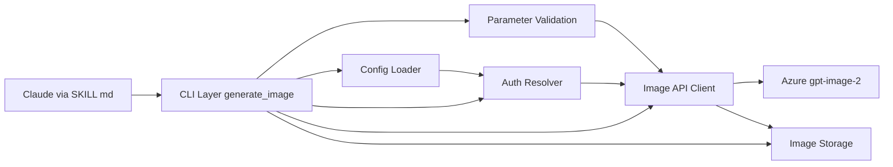
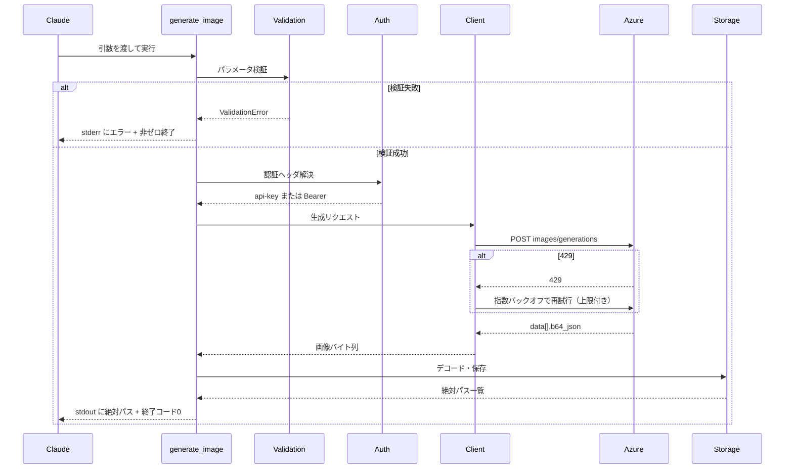

# 技術設計書: gpt-image-2-skill

## Overview

**Purpose**: 本機能は、Claude Code から Azure AI Foundry の `gpt-image-2` を呼び出して画像を生成・ローカル保存する Agent Skill を提供する。Claude は `SKILL.md` の手順に従い、自己完結した CLI スクリプトを呼び出すだけで、API を手書きしない。

**Users**: Claude Code 利用者が対話中に「画像を生成して」と依頼すると、スキルが自動的に読み込まれ、`scripts/generate_image.py` が実行されて生成画像の絶対パスが返る。

**Impact**: 新規（グリーンフィールド）。`.claude/skills/gpt-image-2/` を新設する。

### Goals
- 必須 `--prompt` のみ・他は検証付き任意引数 + デフォルトで画像生成できる CLI を提供する。
- API 呼び出し前にパラメータを検証し（Fail Fast）、不正値を明確なエラーで弾く。
- Entra ID（キーレス）と API キーの両認証経路を、シークレットを漏らさずに扱う。

### Non-Goals
- 画像編集（`images/edits`）・マスク・インペインティング。
- ストリーミング（`stream`/`partial_images`）、バッチ／キュー処理、Web UI。
- API キーのプロビジョニングや Key Vault 連携の実装（運用側で管理）。

## Boundary Commitments

### This Spec Owns
- `scripts/generate_image.py` の CLI 契約（引数・デフォルト・終了コード・stdout/stderr 出力規約）。
- パラメータ検証ルール（size 制約・列挙値・依存関係）。
- Azure 画像生成 API へのリクエスト組み立て、レスポンス（`b64_json`）のデコードとファイル保存。
- 認証情報の取得経路（環境変数）と認証ヘッダの選択ロジック。
- `SKILL.md` の起動条件・使い方・コマンド例。

### Out of Boundary
- Azure リソース／`gpt-image-2` デプロイの作成、limited access 登録。
- シークレットの保管・ローテーション（Key Vault 等の運用）。
- 画像編集・ストリーミング等、初版スコープ外の機能。

### Allowed Dependencies
- Python 3.10+ 標準ライブラリ、`requests`（HTTP）、`azure-identity`（Entra ID トークン取得）。
- 環境変数 `AZURE_OPENAI_ENDPOINT` / `AZURE_OPENAI_DEPLOYMENT` / `AZURE_OPENAI_API_KEY`。
- ローカル `az login` セッションまたは Managed Identity（Entra ID 経路）。

### Revalidation Triggers
- Azure 画像生成 API の契約変更（エンドポイント形式・パラメータ・レスポンス構造）。
- 使用 `api-version` の変更（`background`/`output_compression` の実挙動に影響）。
- 認証方式・環境変数名の変更。
- CLI 引数・デフォルト値の変更。

## Architecture

### Architecture Pattern & Boundary Map

選択パターン: **レイヤード（関数モジュール分割）**。CLI が統括し、検証・認証・API クライアント・保存を独立した関心事として分離する（`research.md` の Architecture Pattern Evaluation 参照）。各層は単体テスト可能で、依存方向は左から右への一方向。



**Architecture Integration**:
- Selected pattern: レイヤード関数分割。検証分岐が多く、各責務の単体テストが受け入れ基準の検証に直結するため。
- Domain/feature boundaries: 検証 / 認証 / HTTP / 保存 を分離。CLI は調整役で業務ロジックを持たない。
- New components rationale: 各層は単一責務（SRP）。Config/Auth がシークルット境界を隔離する。
- Steering compliance: 「ロジックのスクリプト化」「シークレットを環境変数経由でのみ受け渡す」「入力検証の前倒し」（structure.md / tech.md）に準拠。

### 依存方向（強制）
`Types → Config → Validation / Auth → Client → Storage`、CLI が全層を統括。各層は左側の層のみを import し、上位へ依存しない。違反はレビューでエラー扱い。

### Technology Stack

| Layer | Choice / Version | Role in Feature | Notes |
|-------|------------------|-----------------|-------|
| CLI | Python 3.10+ `argparse` | 引数解析・統括・終了コード制御 | 必須は `--prompt` のみ |
| Backend / Services | `requests`（最新安定版） | Azure 画像生成 API への HTTP POST・タイムアウト・リトライ | `openai` SDK も可だが REST 直叩きで依存を最小化 |
| Auth | `azure-identity`（最新安定版） | `DefaultAzureCredential` で Entra ID トークン取得 | 未構成時は API キーへフォールバック |
| Data / Storage | 標準 `base64` / `pathlib` | `b64_json` のデコードとファイル保存 | 一意ファイル名生成 |
| Infrastructure / Runtime | ローカル Python 実行環境 | Claude Code から CLI 起動 | 環境変数で構成 |

> WEBP は Azure 非対応。`background`/`output_compression` の実効性は api-version 依存（`research.md` 参照）。

## File Structure Plan

### Directory Structure
```
.claude/skills/gpt-image-2/
├── SKILL.md                      # 起動条件 description + 前提・パラメータ要約・コマンド例
├── scripts/
│   ├── generate_image.py         # CLI エントリポイント（argparse + 統括 + 終了コード）
│   ├── config.py                 # 環境変数の読み取り（Config データクラス）
│   ├── validation.py             # size 制約・列挙値・依存関係の検証
│   ├── auth.py                   # 認証ヘッダ解決（Entra ID 優先・API キー代替）
│   ├── client.py                 # Azure API クライアント（リクエスト・リトライ・エラー分類）
│   └── storage.py                # b64_json デコードとファイル保存
└── references/
    └── parameters.md             # パラメータ詳細リファレンス（任意）
```

> 単体テスト容易性のため `generate_image.py` を CLI エントリに保ち、業務ロジックを関心事ごとのモジュールに分離する。要件書のファイル構成（`scripts/generate_image.py` 本体）を踏襲しつつ内部分割した形。

## System Flows



主要判断: 検証は API 前に実行（Fail Fast）。429 のみ自動リトライ。その他の HTTP エラーは分類して即時報告。

## Requirements Traceability

| Requirement | Summary | Components | Interfaces |
|-------------|---------|------------|------------|
| 1.1–1.3 | スキル起動・トリガー・SKILL.md 記載 | SKILL.md | （ドキュメント） |
| 2.1–2.4 | CLI 引数・デフォルト・必須/任意・認証非受領 | CLI Layer | `parse_args`, `GenerationParams` |
| 3.1–3.5 | size 制約・列挙値検証 | Validation | `validate_params` |
| 4.1–4.4 | 依存関係検証（透過 PNG・圧縮 JPEG 限定） | Validation | `validate_params` |
| 5.1–5.5 | Base64 デコード・命名・連番・パス出力・出力先 | Storage | `save_images` |
| 6.1–6.6 | 環境変数取得・キーレス優先・直書き/ログ禁止 | Config, Auth | `load_config`, `resolve_auth` |
| 7.1–7.4 | HTTP エラー分類・モデレーション・429 リトライ・終了コード | Client, CLI | `generate`, エラー型 |
| 8.1–8.2 | タイムアウト設定・タイムアウト時エラー | Client | `generate` |

## Components and Interfaces

| Component | Layer | Intent | Req Coverage | Key Dependencies | Contracts |
|-----------|-------|--------|--------------|------------------|-----------|
| CLI Layer | CLI | 引数解析・統括・終了コード/出力制御 | 2, 5, 7 | Config, Validation, Auth, Client, Storage (P0) | Service, State |
| Config Loader | Config | 環境変数の読み取りと検証 | 6 | os.environ (P0) | Service |
| Parameter Validation | Domain | 値域・size 制約・依存関係の検査 | 3, 4 | Types (P0) | Service |
| Auth Resolver | Auth | 認証ヘッダの解決（Entra ID/API キー） | 6 | azure-identity (P1), Config (P0) | Service |
| Image API Client | Service | API 呼び出し・リトライ・エラー分類 | 7, 8 | requests (P0), Auth (P0) | Service, API |
| Image Storage | Data | b64_json デコードとファイル保存 | 5 | base64, pathlib (P0) | Service |

### 型定義（共通）

```python
from dataclasses import dataclass
from typing import Literal, Optional

Quality = Literal["low", "medium", "high"]
OutputFormat = Literal["png", "jpeg"]
Background = Literal["auto", "transparent"]

@dataclass(frozen=True)
class GenerationParams:
    prompt: str
    size: str = "1024x1024"
    quality: Quality = "high"
    output_format: OutputFormat = "png"
    background: Background = "auto"
    output_compression: int = 100
    n: int = 1
    user: Optional[str] = None
    output_dir: str = "./"

@dataclass(frozen=True)
class AzureConfig:
    endpoint: str
    deployment: str
    api_version: str = "2025-04-01-preview"

@dataclass(frozen=True)
class AuthHeader:
    name: str   # "api-key" または "Authorization"
    value: str  # 値は never ログ出力
```

### CLI / Config 層

#### Config Loader

| Field | Detail |
|-------|--------|
| Intent | 環境変数からエンドポイント・デプロイ名・API キーを取得し検証する |
| Requirements | 6.1, 6.2, 6.6 |

**Responsibilities & Constraints**
- `AZURE_OPENAI_ENDPOINT` / `AZURE_OPENAI_DEPLOYMENT`（必須）、`AZURE_OPENAI_API_KEY`（任意）を読み取る。
- 必須未設定時はキー値を含めないエラーを送出。

**Contracts**: Service [x]

```python
def load_config() -> AzureConfig: ...
def load_api_key() -> Optional[str]: ...  # 返り値はログ出力しない
```
- Preconditions: なし。
- Postconditions: `AzureConfig` の必須フィールドは非空。
- Invariants: シークレット値を例外メッセージ・ログに含めない。

### Domain 層

#### Parameter Validation

| Field | Detail |
|-------|--------|
| Intent | size 制約・列挙値・パラメータ依存関係を API 前に検証する |
| Requirements | 3.1, 3.2, 3.3, 3.4, 3.5, 4.1, 4.2, 4.3, 4.4 |

**Responsibilities & Constraints**
- size: `WxH` 形式、両辺 16 の倍数、長辺 ≤3840、比 ≤3:1、総ピクセル数 655,360〜8,294,400。
- 列挙値: quality/output_format/background/n(1〜10) の範囲検証。
- 依存関係: `background=transparent` は `output_format=png` 必須。`output_compression` は jpeg 時のみ有効、png 時は警告して無視（0〜100 に制限）。

**Contracts**: Service [x]

```python
class ValidationError(Exception): ...

def validate_params(params: GenerationParams) -> GenerationParams:
    """検証済みパラメータを返す。png+compression 指定時は警告し compression を無視した値に正規化。"""
```
- Preconditions: `params.prompt` は非空。
- Postconditions: 返却値はすべての制約を満たす。違反時 `ValidationError`。
- Invariants: API 呼び出しは検証通過後にのみ行われる。

**Implementation Notes**
- Validation: 違反項目を具体的に示すメッセージ（例: 「size 1000x1000 は 16 の倍数ではありません」）。
- Risks: `background`/`output_compression` の api-version 依存挙動は事前検証で吸収しきれないため、API 由来 400 は Client 側で報告。

### Auth 層

#### Auth Resolver

| Field | Detail |
|-------|--------|
| Intent | Entra ID 優先・API キー代替で認証ヘッダを解決する |
| Requirements | 6.3, 6.4, 6.5 |

**Dependencies**
- External: `azure-identity` `DefaultAzureCredential` — トークン取得（P1）
- Inbound: Config Loader — API キー取得（P0）

**Contracts**: Service [x]

```python
class AuthError(Exception): ...

def resolve_auth(api_key: Optional[str]) -> AuthHeader:
    """Entra ID トークン取得を試行し成功すれば Bearer。失敗/未構成時は api_key を使用。
    どちらも不可なら AuthError（キー値は含めない）。"""
```
- Postconditions: 返却 `AuthHeader` は有効な認証情報を保持。
- Invariants: トークン・キーを stdout/stderr/ログに出力しない。

### Service 層

#### Image API Client

| Field | Detail |
|-------|--------|
| Intent | Azure 画像生成 API を呼び出し、リトライとエラー分類を行う |
| Requirements | 7.1, 7.2, 7.3, 7.4, 8.1, 8.2 |

**Dependencies**
- External: `requests` — HTTP POST（P0）
- Inbound: Auth Resolver（P0）, Config（P0）

**Contracts**: Service [x] / API [x]

##### API Contract
| Method | Endpoint | Request | Response | Errors |
|--------|----------|---------|----------|--------|
| POST | `{endpoint}/openai/deployments/{deployment}/images/generations?api-version={api_version}` | JSON: prompt, size, quality, n, output_format, background, output_compression?, user? | `{ "data": [ { "b64_json": str } ] }` | 400, 401, 403, 429, timeout |

```python
class ApiError(Exception):
    status: Optional[int]
    kind: Literal["auth", "rate_limit", "bad_request", "moderation", "timeout", "unknown"]

def generate(config: AzureConfig, auth: AuthHeader, params: GenerationParams,
             timeout: float = 120.0, max_retries: int = 3) -> list[bytes]:
    """画像バイト列のリストを返す。429 は指数バックオフで再試行（上限 max_retries）。"""
```
- Preconditions: `params` は検証済み、`auth` は有効。
- Postconditions: 成功時、`n` 件の画像バイト列を返す。
- Invariants: シークレットをログに残さない。エラー時は `ApiError` を送出。

**Implementation Notes**
- Integration: 401/403→`auth`、429→`rate_limit`（リトライ対象）、400→`bad_request`（モデレーション拒否は `moderation` に分類しユーザー向け文言を付与）、接続/読み取りタイムアウト→`timeout`。
- Validation: 自動リトライは 429 のみ。上限到達後は `ApiError` を送出。
- Risks: api-version により `background`/`output_compression` が 400 を誘発しうる旨をメッセージで示す。

### Data 層

#### Image Storage

| Field | Detail |
|-------|--------|
| Intent | b64_json をデコードし一意名でファイル保存、絶対パスを返す |
| Requirements | 5.1, 5.2, 5.3, 5.4, 5.5 |

**Contracts**: Service [x]

```python
def save_images(images: list[bytes], output_dir: str, output_format: OutputFormat) -> list[str]:
    """各画像を gpt-image-2_<timestamp>_<index>.<ext> として保存し、絶対パスのリストを返す。
    output_dir が存在しなければ作成。"""
```
- Postconditions: 保存件数 == 入力件数。返却は絶対パス。
- Invariants: ファイル名は一意（timestamp + index）。`n>1` は連番。

## Error Handling

### Error Strategy
Fail Fast（検証は API 前）+ エラー種別の分類 + 安全なメッセージ（シークレット非出力）。すべての異常系は非ゼロ終了コードで終了。

### Error Categories and Responses
- **User Errors（検証/4xx）**: `ValidationError`（不正パラメータ）→ 違反項目を `stderr` に明示。400 `bad_request`/`moderation` → 原因とユーザー向け対処を提示。401/403 `auth` → 認証設定の確認を促す（キー値は出さない）。
- **System Errors（5xx/timeout）**: `timeout` → 明確なエラーと非ゼロ終了。一時的障害は必要に応じ報告。
- **Rate Limit（429）**: 上限付き指数バックオフで自動リトライ。上限超過で `ApiError` を報告。

### Monitoring
- すべてのエラーは `stderr` に種別と原因を出力。`stdout` は成功時の絶対パスのみ。ログ/出力にシークレットを一切含めない。

## Testing Strategy

### Unit Tests
- `validate_params`: 16px 非倍数・4K 超・比 3:1 超・ピクセル数範囲外・列挙値外をそれぞれ `ValidationError`（3.x）。
- `validate_params`: `background=transparent`+`format=jpeg` がエラー、`png`+`compression` 指定で警告かつ無視（4.1, 4.2）。
- `resolve_auth`: Entra ID 成功時 Bearer、未構成時 API キー、両不可時 `AuthError`（6.3–6.5）。
- `save_images`: 命名規則・連番・絶対パス返却・出力ディレクトリ作成（5.2, 5.3, 5.4, 5.5）。
- `load_config`: 必須環境変数未設定でキー非出力のエラー（6.6）。

### Integration Tests
- `--prompt` のみ → デフォルトで生成・保存（モック API でレスポンス→保存まで）（2.2, 5.1）。
- `--n 3` → 3 枚が連番保存（5.3）。
- 429 レスポンス → 指数バックオフ後に成功 / 上限超過で `ApiError`（7.3）。
- 400 モデレーション応答 → ユーザー向けメッセージ（7.2）。

### E2E Tests（実環境・任意）
- Entra ID（`az login` 済み）経路で実生成。
- API キー経路で実生成。
- `background transparent --format png` の透過 PNG 出力検証。

## Security Considerations
- シークレットは環境変数経由のみ。`SKILL.md`・スクリプトに直書きしない（6.2）。
- API キー・トークンを `stdout`/`stderr`/ログ・例外メッセージに含めない（6.5）。
- Entra ID キーレスを既定とし、長期キーの保存を回避（6.3）。API キー利用時は Key Vault 管理・ローテーションを運用側で推奨。

## Performance & Scalability
- API 呼び出しタイムアウト既定 120 秒（通常生成 10〜30 秒に余裕）（8.1）。
- 429 のみ指数バックオフ（上限付き）でリトライ（7.3）。
